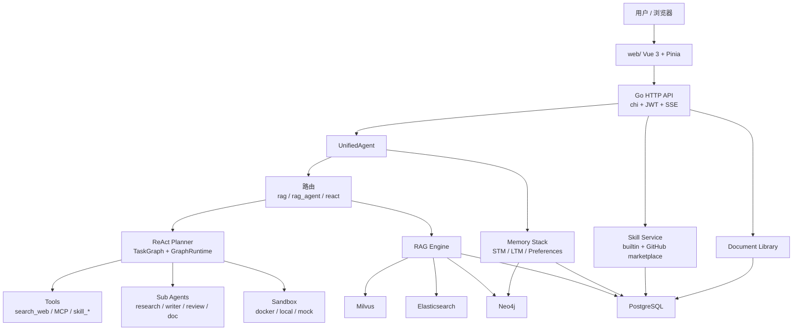
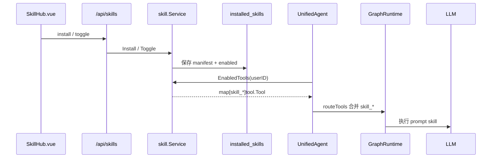

# AGI-saber

面向日常办公任务的个人 AI 助手。

服务由 Go API 和独立 Web 界面组成。API 入口位于 `cmd/server/main.go`，负责账号认证、SSE 对话、知识检索、记忆、工具、Skill、文档及运行状态；`web/` 下是基于 Vite、Vue 3 和 Pinia 的前端。开发环境需要分别运行前后端。

## 当前能力

- 账号与访问控制：提供注册、登录和 JWT 校验。健康检查以及注册、登录接口不要求 token，其余业务请求需要通过认证。
- SSE 对话：客户端可从 `/api/chat/stream` 持续接收 route、step、token、done 等阶段事件。
- 任务编排：Planner 把请求拆成任务图，GraphRuntime 负责并发调度、竞速、失败重试、状态快照，以及必要时重新规划。
- 检索增强：可以上传文本、PDF 等资料。Milvus、Elasticsearch 和 Neo4j 分别承担语义、BM25 和图检索；服务可用时合并检索结果，连接不可用时按配置降级。
- 用户记忆：覆盖当前会话、长期信息和偏好设置。长期记忆提供合并、去重、衰减、隔离及 superseded 记录查询。
- Agent 协作：`research_agent`、`writer_agent`、`review_agent` 与 `doc_agent` 串接知识收集、写作、审阅和文档保存。
- 文档管理：支持保存和查阅 Markdown 文档，也可以删除文档对应的 RAG 数据或重新执行入库。
- 外部工具：默认提供 `search_web`，并允许登记 MCP HTTP 工具。常规聊天请求默认交给 ReAct loop 处理。
- Skill：包含办公类 prompt skill，并能从 GitHub 搜索结果中安装其他 prompt skill。
- 任务产物：沙箱可选择 Docker、local 或 mock 后端，并为复杂请求准备宿主机上的产物目录。
- 依赖容错：PostgreSQL、Milvus、Elasticsearch、Kafka 和 Neo4j 根据连接情况启用或降级。API 可以在部分依赖缺失时运行，但对应功能可能不可用。

> GitHub Skill 的实现范围是将仓库名称和简介整理为 prompt 上下文，再交给本地 LLM 使用；目前不会克隆仓库，也不会运行其中的代码。

## 架构概览



## 技术栈

- Backend: Go 1.24, chi, JWT, PostgreSQL driver, Milvus SDK, Elasticsearch client, Neo4j driver, Kafka client.
- Frontend: Vue 3, Vite, Pinia.
- Infra: PostgreSQL, Milvus + etcd + MinIO, Elasticsearch, Kafka KRaft, Neo4j.
- LLM API: OpenAI-compatible chat endpoint; 默认配置示例使用智谱 API 地址。

## 快速开始

### 1. 准备环境

建议版本：

- Go 1.24+
- Node.js 18+
- Docker Desktop / Docker Engine

### 2. 配置密钥

后端启动强制要求 `JWT_SECRET` 至少 32 字节：

```bash
export JWT_SECRET="replace-with-at-least-32-bytes-secret"
```

可选环境变量：

```bash
export GITHUB_TOKEN="ghp_xxx"      # Skill 广场搜索 GitHub 时提额，可不填
export PPROF_ADMIN_TOKEN="xxx"     # 仅 observability.pprof.enabled=true 时需要
```

然后按需编辑 [config/config.yaml](config/config.yaml)：

- `llm.api_url` / `llm.api_key` / `llm.model`
- `llm.fast_model`
- `embedding.api_url` / `embedding.api_key` / `embedding.model`
- `search.api_key` / `search.api_url`
- `skillhub.enabled` / `skillhub.keyword`
- `sandbox.backend` / `sandbox.artifact_host_dir`

配置文件里的 `"."` 只是占位符。因为非空字符串会被视为“已配置真实 API”，如果不替换，LLM 请求会失败后降级 mock。

### 3. 启动基础设施

```bash
docker compose up -d
```

该命令会拉起以下本地依赖：

- PostgreSQL: `localhost:5432`
- Milvus: `localhost:19530`
- Elasticsearch: `localhost:9200`
- Kafka: `localhost:29092`
- Neo4j: `localhost:7474` / `localhost:7687`

若只需启动基础 API，可以暂时不运行这些容器。服务会尝试以降级模式工作；登录注册、Skill 安装、持久化记忆等依赖 PostgreSQL 的功能将无法正常使用。

### 4. 启动后端

```bash
go mod download
go run ./cmd/server
```

默认监听：

```text
http://localhost:8090
```

健康检查：

```bash
curl http://localhost:8090/healthz
curl http://localhost:8090/readyz
```

### 5. 启动前端

```bash
cd web
npm install
npm run dev
```

访问：

```text
http://localhost:5173
```

开发服务器的 `web/vite.config.js` 已配置代理，会将 `/api`、`/healthz` 和 `/readyz` 请求转发至 `http://localhost:8090`。

## 常用命令

```bash
# 后端测试
go test ./...

# 前端构建
cd web && npm run build

# 前端本地预览生产包
cd web && npm run preview

# 停止基础设施
docker compose down

# 停止并删除数据卷
docker compose down -v
```

## 使用流程

1. 在 Web 界面创建账号或登录。
2. 未开启知识库时，聊天请求默认由 `react` 模式处理；Planner 会根据任务决定是否调用工具或 Skill。
3. 启用知识库后，系统按请求类型选择路径：
   - 一般知识问答使用 `rag`。
   - 报告、方案、摘要和文档任务使用 `rag_agent`，依次经过 research、writer、review、doc。
4. Skill 安装完成后，还需到“已安装”列表启用它，主循环才会加载该 Skill。
5. 上传的资料可参与 RAG 检索。`doc_agent` 生成并保存的报告也能写入文档库，随后进入 RAG 索引。

## Skill 机制

Skill 的数据模型定义在 `internal/domain/skill`，对应的应用层逻辑位于 `internal/application/skill`。

Skill 目前有两种调用形式：

- `prompt`：将 Skill 的 `PromptTemplate` 填充后提交给 LLM。办公 Skill 和 GitHub Skill 当前均采用此方式。
- `mcp`：调用外部 HTTP MCP 服务，作为后续扩展能力保留。

安装与调用链：



运行规则：

- GitHub Skill 仅向 prompt 提供仓库描述，不会执行仓库中的程序。
- 只有当前用户启用的 Skill（`enabled=true`）会加入 `routeTools`。
- Skill 会并入普通 `react` loop；单纯的 RAG 问答路径不会加载它们。
- Skill 节点需要调用 LLM，GraphRuntime 对这类步骤使用更宽的超时，避免被普通工具默认的 5 秒限制提前终止。

## API 摘要

以下接口不需要登录 token：

| Method | Path | 说明 |
| --- | --- | --- |
| `POST` | `/api/auth/register` | 注册并返回 token |
| `POST` | `/api/auth/login` | 登录并返回 token |
| `GET` | `/healthz` | 存活检查 |
| `GET` | `/readyz` | 就绪检查 |

其他业务接口通过 `Authorization: Bearer <token>` 进行认证：

| Method | Path | 说明 |
| --- | --- | --- |
| `GET` | `/api/auth/me` | 当前用户 |
| `POST` | `/api/chat` | 同步对话 |
| `POST` | `/api/chat/stream` | SSE 流式对话 |
| `POST` | `/api/chat/cancel` | 取消当前请求 |
| `POST` | `/api/upload` | 上传文件或文本入库 RAG |
| `POST` | `/api/docs/delete` | 删除 RAG 文档 chunks |
| `GET` | `/api/documents/` | 文档库列表 |
| `POST` | `/api/documents/` | 写入文档库 |
| `GET` | `/api/documents/{documentID}` | 获取文档 |
| `POST` | `/api/documents/{documentID}/ingest` | 文档重新入库 RAG |
| `GET` | `/api/memory/` | 记忆快照 |
| `GET` | `/api/memory/quarantined` | 被隔离记忆 |
| `POST` | `/api/memory/quarantine` | 隔离记忆 |
| `POST` | `/api/memory/unquarantine` | 解除隔离 |
| `GET` | `/api/memory/superseded` | 被替代记忆 |
| `GET` | `/api/tools` | 当前全局工具列表 |
| `POST` | `/api/tools/mcp` | 注册 MCP HTTP 工具 |
| `GET` | `/api/skills/marketplace` | Skill 广场 |
| `GET` | `/api/skills/installed` | 当前用户已安装 Skill |
| `POST` | `/api/skills/install` | 安装 Skill |
| `POST` | `/api/skills/uninstall` | 卸载 Skill |
| `POST` | `/api/skills/toggle` | 开关 Skill |
| `GET` | `/api/snapshots` | ReAct 任务快照 |
| `GET` | `/api/status` | 服务状态 |

流式响应中常见的 SSE 事件有：

- `start`
- `route`
- `memory`
- `graph_ready`
- `node_start`
- `node_done`
- `step`
- `sandbox_ready`
- `rag_result`
- `token`
- `done`

## 目录结构

```text
.
├── cmd/server/                 # 后端入口
├── config/                     # YAML 配置加载与默认值
├── internal/
│   ├── application/
│   │   ├── auth/               # 注册、登录、JWT 应用服务
│   │   ├── chat/               # UnifiedAgent、ReAct、RAG 路由、子 Agent、文档库
│   │   └── skill/              # Skill 广场应用服务
│   ├── domain/                 # 领域模型：tool / skill / rag / memory / document / sandbox
│   ├── infrastructure/         # LLM、持久化、平台连接、skillhub、工具实现
│   ├── interfaces/http/        # chi handler + middleware
│   ├── pkg/logger/             # slog 封装
│   └── usercontext/            # userID context helpers
├── web/                        # Vue 3 前端
├── docs/                       # 架构文档和示例 skill 文档
├── docker-compose.yml          # 本地基础设施
├── Dockerfile                  # 后端镜像
└── go.mod
```

## 数据与持久化

PostgreSQL 用于保存以下数据：

- 用户和密码哈希
- 聊天历史
- 用户偏好
- 长期记忆
- RAG chunks 元数据
- 文档库
- task snapshots
- installed skills

向量索引由 Milvus 管理，Elasticsearch 提供 BM25 检索，Neo4j 存储知识图谱与图增强记忆，Kafka 承担事件发布。

外部基础设施连接异常通常不会阻止服务启动，但依赖该服务的功能会受影响。比如 PostgreSQL 无法连接时，账号注册登录、Skill 安装、记忆保存和文档持久化都无法使用。

## 配置重点

| 配置 | 说明 |
| --- | --- |
| `server.port` | 后端监听端口，默认 `8090` |
| `auth.jwt_secret` | JWT 密钥，生产必须用环境变量注入 |
| `llm.model` | 最终回答模型 |
| `llm.fast_model` | Planner、参数抽取、子 Agent、RAG 改写等内部步骤模型 |
| `embedding.model` | RAG 和记忆用向量模型 |
| `rag.rag_milvus_dim` | Milvus 向量维度，需和 embedding 模型一致 |
| `harness.step_timeout_ms` | 普通工具单步超时 |
| `graph_runtime.max_parallel` | 图执行最大并行节点数 |
| `sandbox.backend` | `docker` / `local` / `mock` |
| `sandbox.artifact_host_dir` | 任务产物输出目录 |
| `skillhub.enabled` | 是否启用 GitHub Skill 广场 |
| `skillhub.keyword` | GitHub 搜索关键词，多词是 AND |

## 部署说明

Dockerfile 生成的镜像只包含 Go API。部署前端时，请单独构建 Web 资源，并交给 nginx 或其他静态文件服务托管：

```bash
cd web
npm run build
```

生产环境可按以下方式部署：

- 前端静态站点托管 `web/dist/`。
- nginx 将 `/api`、`/healthz`、`/readyz` 反代到后端。
- 不要提交真实 API Key、JWT_SECRET、GitHub Token。
- 如果开启 pprof，必须设置 `PPROF_ADMIN_TOKEN`，并限制访问来源。

`web/nginx.conf.example` 提供了反代示例。

## 常见问题

**访问 `http://localhost:8090` 时只看到 API 提示，是否异常？**

这是预期行为。前端不由 API 服务提供，请启动 `web/` 中的 Vite 开发服务器，或把 `web/dist/` 部署到静态服务器。

**为什么业务请求得到 401？**

除 `/api/auth/register`、`/api/auth/login`、`/healthz` 和 `/readyz` 以外，接口都要求 JWT。登录后前端会自动附带 token。

**已安装的 Skill 没有被使用？**

请检查它是否已在“已安装”列表中启用。只有普通 `react` loop 会加载 Skill；RAG 简单问答不会经过这一步。

**GitHub Skill 为什么不像代码插件那样执行功能？**

当前实现只将 GitHub 仓库信息转成 prompt 上下文，不会克隆或运行仓库代码。

**LLM 请求总是回退到 mock？**

请核对 `llm.api_key`、`llm.api_url`、模型名称和网络连通性。配置中的 `"."` 仅是占位值，系统仍会发起请求，但请求通常无法成功。

**检索结果偏差较大，或 Milvus 提示向量维度不匹配？**

检查 `rag.rag_milvus_dim` 是否等于 embedding 模型输出维度。若调整过维度，还需要清理旧的 Milvus collection 或数据卷。

## 测试状态

可通过以下命令运行后端测试：

```bash
go test ./...
```

前端尚未提供单独的单元测试命令，可先执行构建检查：

```bash
cd web
npm run build
```

## 许可证

目前仓库没有附带开源许可证文件。计划公开发布或用于商业场景前，请先明确并添加 LICENSE。
